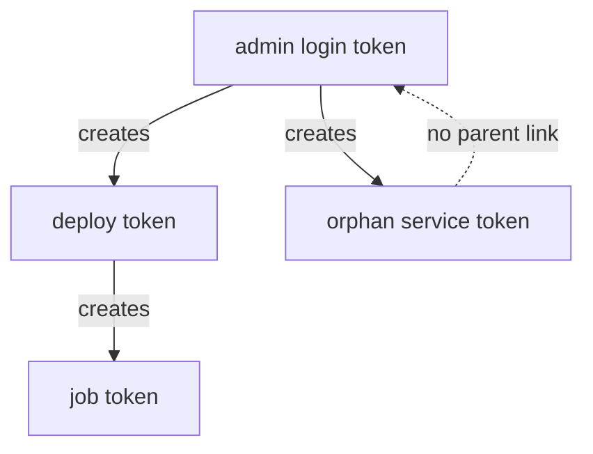

# Service And Batch Tokens, Orphans And Token Roles

A busy platform creates thousands of tokens an hour, and not all of them need the same features. Some must be renewed for months; others are used once and thrown away. Some must die with the session that created them; others must survive it. This part covers the two token types, the token tree that ties tokens to their parents, and token roles, which let you decide these settings once instead of on every `bao token create`.

## Service tokens and batch tokens

OpenBao has two token types. A **service token** is stored in OpenBao's token store: it can be renewed, it can create child tokens, and it can be looked up and revoked one by one. A **batch token** is not stored at all: it is an encrypted blob that carries its own policies and expiry, so creating one costs OpenBao almost nothing. The table shows what that trade costs.

| Feature | Service token | Batch token |
| --- | --- | --- |
| Can be renewed | Yes | No |
| Can create child tokens | Yes | No |
| Can be periodic | Yes | No |
| Has an accessor | Yes | No |
| Can be revoked by itself | Yes | No; it expires, or dies with its parent |
| Cost to create | A write to storage | Almost none |

Create one of each and compare their lookups:

<!-- astrona:playground:renew -->

```sh
export BAO_ADDR=http://openbao.localtest.me:8200
export BAO_TOKEN=$(kubectl -n openbao get secret openbao-init -o jsonpath='{.data.root-token}' | base64 -d)
BATCH_TOKEN=$(bao token create -type=batch -policy=reporting -ttl=10m -field=token)
bao token lookup $BATCH_TOKEN
```

The batch token is much longer than a service token, because it carries its own data, and its lookup shows `type` as `batch` and no accessor. Batch tokens suit short, high-volume jobs, such as a pipeline step that reads one secret and exits.

## The token tree

Every service token remembers which token created it. Together they form a tree, with root tokens and orphan tokens at the top. When OpenBao revokes a token, it revokes every token below it too. This is what makes revocation safe: revoke an administrator's login token and every token that person handed out disappears with it.



The diagram shows one tree: revoking the admin login token also revokes the deploy token and the job token, but not the orphan service token, which has no parent. See it happen with three tokens:

```sh
PARENT_TOKEN=$(bao token create -policy=reporting -field=token)
CHILD_TOKEN=$(BAO_TOKEN=$PARENT_TOKEN bao token create -policy=reporting -field=token)
bao token revoke $PARENT_TOKEN
bao token lookup $CHILD_TOKEN
```

The last lookup fails: the child token was revoked together with its parent. A token created with `-orphan` would have survived. Use orphans for services whose lifetime has nothing to do with the person who set them up, and keep normal child tokens for everything else.

## Token roles

Typing `-orphan -period=24h -policy=reporting` correctly every time is how mistakes happen. A **token role** stores those settings once, at `auth/token/roles/<name>`, and every token created with `-role=<name>` gets them. The role can also limit which policies a token may have, so a team can create its own tokens without being able to give itself more.

```sh
bao write auth/token/roles/reporting \
  allowed_policies=reporting orphan=true token_period=24h
bao token create -role=reporting -policy=reporting
```

The new token is an orphan with a 24-hour period and the policy `reporting`, and its lookup shows `role` as `reporting`. Now try to ask for more than the role allows:

```sh
bao token create -role=reporting -policy=inventory-read
```

OpenBao refuses, because `inventory-read` is not in `allowed_policies`. A role is only as safe as its list of allowed policies: a role that allows a broad policy lets anyone who may use the role create tokens with it.

You now know how to pick a token type, how revocation moves down the token tree, and how a token role fixes the settings of the tokens it issues. Together with TTLs and periods, these are all the settings every login in OpenBao ends up producing.

## Common pitfalls

> [!WARNING]
> - **Expecting to renew or revoke a batch token.** It has no accessor and cannot be renewed or revoked on its own. Give it a short TTL.
> - **Revoking a parent and losing a service's token.** Tokens created by a person's login token die with it. Create service tokens as orphans or through a role with `orphan=true`.
> - **A token role that allows too much.** `allowed_policies` is the real limit of the role. Never put `root` or a broad administrator policy there.
> - **Changing a role and expecting old tokens to change.** A role's settings apply when a token is created, except the period, which OpenBao reads from the role again at every renewal.
