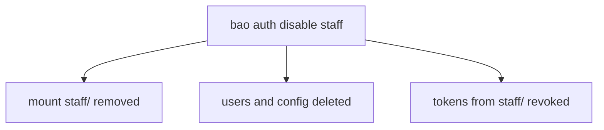

# Enable, List And Disable Auth Methods

Before anyone can log in, an administrator has to mount an auth method. The mount is a small object with a path, a type and a set of settings, and almost every later problem with logins traces back to which mount was created where. This part shows how to create, inspect and remove mounts, and what removal costs.

## Mount an auth method

A new OpenBao server has one auth method, `token`, mounted at `auth/token/`. It cannot be disabled, because every login ends in a token. To add a second method, enable it with `bao auth enable` and the type name. Connect first, using the lab-only root token:

<!-- astrona:playground:renew -->

```sh
export BAO_ADDR=http://openbao.localtest.me:8200
export BAO_TOKEN=$(kubectl -n openbao get secret openbao-init -o jsonpath='{.data.root-token}' | base64 -d)
bao auth enable userpass
bao auth list
```

The list shows two rows: `token/` of type `token` and `userpass/` of type `userpass`. The path is the type name by default, so all requests for this method go to `auth/userpass/`.

A **mount path** is the place where the auth method answers requests. You choose it with `-path`, and you can add a description that shows in the list:

```sh
bao auth enable -path=staff -description="Logins for staff" userpass
bao auth list -detailed
```

Now the same type is mounted twice, at `userpass/` and at `staff/`. The two mounts do not share users: a user created under `auth/staff/users/` cannot log in at `auth/userpass/login/`. The `-detailed` output adds the **accessor** of each mount, an ID such as `auth_userpass_1a2b3c4d`, which stays the same even if you later move the mount. Policies, audit logs and the identity system refer to a mount by its accessor.

## Read one mount

`bao auth list` is the command-line form of a request to `sys/auth`. You can read the settings of a single mount through the same API:

```sh
bao read sys/auth/staff
```

The response shows the type, the description, the accessor and a `config` block with the lease limits and the token type. The next part changes those values.

## Disable a mount

`bao auth disable` removes a mount. Try it on a mount that has a user and a live token. Create a user, log in, and look at the token:

```sh
bao write auth/staff/users/temp password=temp-password token_policies=inventory-read
bao write -field=token auth/staff/login/temp password=temp-password > /tmp/temp-token
bao token lookup "$(cat /tmp/temp-token)"
```

The lookup shows a token with the policy `inventory-read`. Now disable the mount and look the token up again:

```sh
bao auth disable staff
bao token lookup "$(cat /tmp/temp-token)"
```

The second lookup fails because the token no longer exists. OpenBao revoked every token that the `staff` mount issued when it removed the mount. It also deleted the mount's users and configuration. Disabling is not reversible: enabling a mount again at the same path gives an empty mount.



The diagram shows the three effects of one command. Because a disable revokes live sessions, check the mount's accessor with `bao auth list -detailed` before you run it, and use `bao token lookup` on a suspect token to read its `path` field, which names the mount that issued it.

You now know how to create several mounts of one type, tell them apart by path and accessor, and remove one. A mount starts with default limits, though, and the defaults rarely fit. The next part changes them.

## Common pitfalls

> [!WARNING]
> - **Disabling the wrong mount.** All tokens from it are revoked at once, and its users are gone. Read `bao auth list -detailed` first.
> - **Enabling a second `userpass` and expecting shared users.** Each mount has its own users. Pick one path and keep it.
> - **Trying to disable `token/`.** OpenBao refuses; the token method is built in.
> - **Writing to `auth/userpass/` when the mount is at `auth/staff/`.** The request fails with an unsupported path error. Check the path in `bao auth list`.
