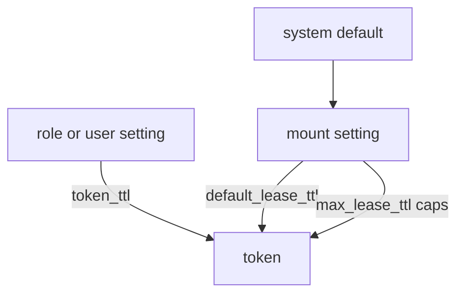

# Tune An Auth Method

Every mount starts with the same defaults: a token lives 768 hours (32 days) by default and can never live longer, whatever the method is. A mount for staff and a mount for short-lived automation should not share these limits. This part shows the settings that belong to the mount itself, and how they relate to the settings on a user or role.

## Lease limits on a mount

A **lease** is the period a token or a secret stays valid. A mount has two lease settings that act as limits for every token it issues. The **default lease TTL** is the TTL a token gets when the user or role does not ask for one. The **max lease TTL** is the longest a token from this mount can ever live, even with renewals. If the max lease TTL is not set on the mount, the system value applies. Both values come from the mount's `config` block.

Enable a mount and read its limits:

<!-- astrona:playground:renew -->

```sh
export BAO_ADDR=http://openbao.localtest.me:8200
export BAO_TOKEN=$(kubectl -n openbao get secret openbao-init -o jsonpath='{.data.root-token}' | base64 -d)
bao auth enable -path=staff userpass
bao read -format=json sys/auth/staff | jq '.data.config'
```

The `config` block shows `default_lease_ttl` and `max_lease_ttl` as `0`, which means that the system defaults apply. Change them with `bao auth tune`:

```sh
bao auth tune -default-lease-ttl=2h -max-lease-ttl=8h auth/staff
bao read -format=json sys/auth/staff | jq '.data.config'
```

The values now read `7200` and `28800` seconds. A user at this mount who logs in without a TTL setting gets a token that lives two hours, and no renewal can extend it past eight hours.

## Token type and listing visibility

Two more settings change how the mount behaves. The **token type** decides whether a login returns a service token or a batch token. A service token is stored by OpenBao and can be renewed; a batch token is a self-contained value that OpenBao does not store, which makes it cheap but not renewable. The setting `-token-type=default-service` returns a service token unless the role says otherwise; other values are `default-batch`, `service` and `batch`.

```sh
bao auth tune -token-type=default-service auth/staff
```

The **listing visibility** decides whether the mount shows in the unauthenticated list of mounts that the web interface reads. The default is `hidden`. Setting it to `unauth` shows the mount's path, type and description to anyone who asks, without a token, which is how a login page can offer a list of sign-in methods.

```sh
bao auth tune -listing-visibility=unauth -description="Logins for staff" auth/staff
bao read -format=json sys/auth/staff | jq '.data | {description, config}'
```

The output includes the new description and `listing_visibility` set to `unauth`.

## Other tune options

Two options matter for auditing and for custom headers. `-audit-non-hmac-request-keys` and `-audit-non-hmac-response-keys` name fields that the audit log writes in plain text instead of as a hash. `-passthrough-request-headers` and `-allowed-response-headers` name HTTP headers that the mount may receive or return. Leave them at their defaults unless a plugin documents that it needs them.



The diagram shows the order: the role or user value wins when it is set, the mount default applies when it is not, and the mount's max lease TTL caps both.

Now you know how to change the limits that belong to a mount. The role or user can still ask for its own values within these limits, and the next part shows the fields it uses.

## Common pitfalls

> [!WARNING]
> - **Setting `-max-lease-ttl` lower than a role's `token_ttl`.** The token gets the lower value without an error. Read the token with `bao token lookup` to see what it really received.
> - **Expecting a tune to change tokens that already exist.** A tune applies to new logins and renewals only.
> - **Using `-listing-visibility=unauth` on every mount.** It lists the mount to anyone who can reach the server. Use it only for mounts that a login page must show.
> - **Forgetting the `auth/` prefix.** `bao auth tune` takes `auth/staff`, not `staff`.
