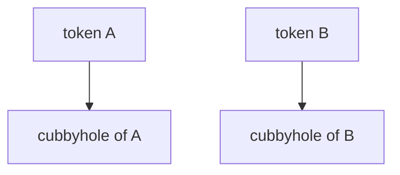

# The Cubbyhole

Response wrapping depends on one small feature that is easy to overlook: every token has a private store of its own. This part shows what that store is, what can read it and when it disappears. Once the store is clear, the wrapping token in the next part has a place to live.

## A private store for every token

The **cubbyhole** is a secrets engine mounted at `cubbyhole/`. It looks like a simple key-value store, but each token sees a different one. A token can read, write, list and delete paths below `cubbyhole/`, and it sees only the paths that it wrote itself. Not even the root token can read the cubbyhole of another token.

Connect to the playground and write a note into the cubbyhole of the root token:

<!-- astrona:playground:renew -->

```sh
export BAO_ADDR=http://openbao.localtest.me:8200
export BAO_TOKEN=$(kubectl -n openbao get secret openbao-init -o jsonpath='{.data.root-token}' | base64 -d)
bao write cubbyhole/note text="remember the maintenance window"
bao read cubbyhole/note
```

The read shows the key `text` with the value you wrote. Now create a second token and look at the same path with it:

```sh
OTHER_TOKEN=$(bao token create -policy=default -field=token)
BAO_TOKEN=$OTHER_TOKEN bao read cubbyhole/note
```

The command prints nothing and reports that no value was found at `cubbyhole/note`. The second token has its own empty cubbyhole, even though it has the same path. The `default` policy already allows a token to use its own cubbyhole, so no extra policy is needed.



The diagram shows that the path `cubbyhole/` is the same for both tokens, but each token reaches a different store.

## When the cubbyhole disappears

The cubbyhole belongs to the token and has the token's lifetime. When the token expires or is revoked, OpenBao deletes the cubbyhole with it. Prove it with a token that you revoke:

```sh
SHORT_TOKEN=$(bao token create -policy=default -ttl=1h -field=token)
BAO_TOKEN=$SHORT_TOKEN bao write cubbyhole/temp value=42
bao token revoke $SHORT_TOKEN
BAO_TOKEN=$SHORT_TOKEN bao read cubbyhole/temp
```

The last command fails with a `permission denied` error, because the token no longer exists, and its data is gone.

## Why this matters for secrets

The cubbyhole is the safe place for a secret that only one token should ever see. A token that sits in an application's memory can keep working state there without any other token being able to touch it. OpenBao also uses it for a second purpose: it stores the response that a wrapping token protects. That is the subject of the next part.

You now know that a cubbyhole is private, per token and temporary. The question that remains is how to put a response in the cubbyhole of a new token and give only that token to someone else.

## Common pitfalls

> [!WARNING]
> - **Expecting the root token to read another token's cubbyhole.** It cannot, and that is the design. An administrator who needs the data must ask for it differently.
> - **Using the cubbyhole for data that must outlive a token.** The data is deleted with the token. Store lasting data in a KV engine.
> - **Writing to `cubbyhole/` with a token that has no `default` policy.** A token created with `-no-default-policy` has no access to its own cubbyhole unless a policy allows it.
