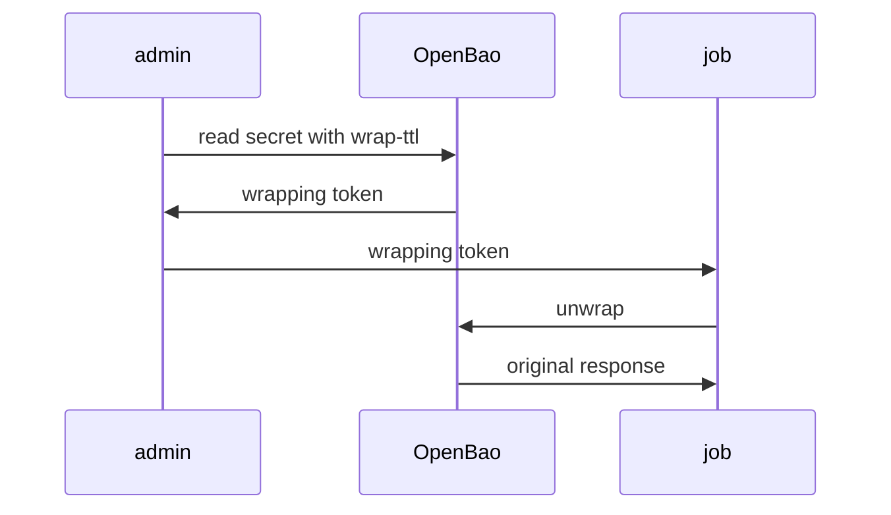

# Wrap And Unwrap A Response

Reading a secret returns the secret to the caller, and everything between OpenBao and the caller can see it: the terminal, the shell history, a log, a pipeline. Response wrapping changes what is returned. OpenBao stores the response in the cubbyhole of a fresh token and returns only that token. This part shows the commands and the single-use rule.

## Ask for a wrapped response

Any request can be wrapped by adding a **wrapping TTL**, the number of minutes or hours the wrapping token stays valid. On the command line the flag is `-wrap-ttl`:

<!-- astrona:playground:renew -->

```sh
export BAO_ADDR=http://openbao.localtest.me:8200
export BAO_TOKEN=$(kubectl -n openbao get secret openbao-init -o jsonpath='{.data.root-token}' | base64 -d)
bao kv get -wrap-ttl=5m secret/inventory/db
```

The command does not print the secret. It prints a table with the fields `wrapping_token`, `wrapping_accessor`, `wrapping_token_ttl`, `wrapping_token_creation_time` and `wrapping_token_creation_path`. The creation path is `secret/data/inventory/db`, the request that was wrapped. The caller holds a token that is worth nothing to anyone who cannot reach OpenBao.

## Unwrap once

Save the wrapping token and unwrap it with `bao unwrap`:

```sh
WRAPPING_TOKEN=$(bao kv get -wrap-ttl=5m -field=wrapping_token secret/inventory/db)
bao unwrap $WRAPPING_TOKEN
```

The command prints the original response: the secret data and its metadata, as if you had called `bao kv get` without wrapping. The wrapping token is now used up. Run the same unwrap again:

```sh
bao unwrap $WRAPPING_TOKEN
```

This time OpenBao returns an error that the wrapping token is not valid or does not exist. A wrapping token works exactly once, and that is its main security property. It also holds true for the person who created it: the creator cannot read the content again either.



The diagram shows that the secret itself never travels between the administrator and the job. Only the wrapping token does, and the job gets the secret directly from OpenBao.

## What the unwrap request needs

The unwrap request authenticates with the wrapping token itself, so the job needs no other credential and no policy. That is why `bao unwrap` takes the token as an argument. You can also use the HTTP API: a `POST` to `/v1/sys/wrapping/unwrap` with the header `X-Vault-Token` set to the wrapping token, and an empty body.

```sh
WRAPPING_TOKEN=$(bao kv get -wrap-ttl=5m -field=wrapping_token secret/inventory/db)
curl -s -X POST -H "X-Vault-Token: $WRAPPING_TOKEN" $BAO_ADDR/v1/sys/wrapping/unwrap | jq '.data.data'
```

The result is the secret data. The same call a second time returns an error.

## The wrapping TTL

If nobody unwraps the token within the wrapping TTL, it expires and the stored response is deleted. An expired wrapping token behaves like a used one. The creator can ask for a new one. Choose the TTL for how long the delivery really takes: a few minutes for an automated job, longer when a person must act.

You now know how to wrap a read and open the result exactly once. Before you hand a wrapping token to someone, you would like to confirm what it contains without opening it, and the next part shows how.

## Common pitfalls

> [!WARNING]
> - **Unwrapping to test the token.** The test uses it up. Look it up instead.
> - **A very long wrapping TTL.** The longer the token lives, the more time an attacker has. Use the shortest TTL that fits the delivery.
> - **Sending the wrapping token over the same channel as an unprotected copy of the secret.** The wrapping protects nothing then.
> - **Keeping the wrapping token in shell history on a shared host.** Use it from a variable and clear the history entry for a long-lived one.
