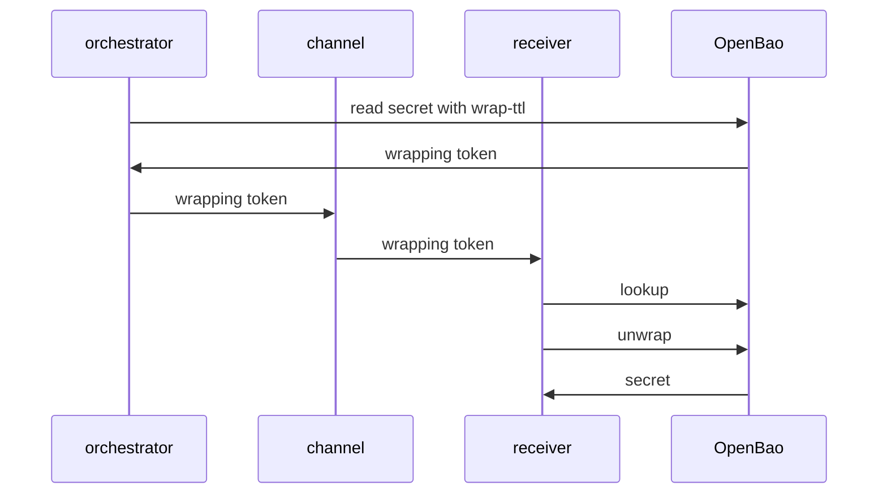

# Safe Delivery With Wrapped Responses

Each feature so far works alone. This part joins them into a delivery workflow and explains what the receiver learns from a failure. The idea behind the workflow is that a wrapping token turns a secret leak into an event you can see.

## Who does what

A delivery has three roles. A **trusted orchestrator** is the program or person with the rights to read the secret. A **receiver** is the job that needs it. The **channel** is anything that carries the wrapping token between them, such as a CI variable or a Kubernetes Secret, and it is not trusted.



The diagram shows that the channel only ever sees the wrapping token, and that the receiver looks the token up before it opens it.

The receiver follows a fixed order. It looks up the token and compares the creation path with the path it expects. If the lookup fails, the token is already used, expired or forged, and the receiver stops and raises an alert. If it passes, the receiver unwraps the token, uses the secret, and discards the wrapping token variable.

## Wrapped tokens

Wrapping is not limited to secrets. When you create a token for a job, the token itself is a secret, and you can wrap that too. The `-wrap-ttl` flag works on `bao token create`:

<!-- astrona:playground:renew -->

```sh
export BAO_ADDR=http://openbao.localtest.me:8200
export BAO_TOKEN=$(kubectl -n openbao get secret openbao-init -o jsonpath='{.data.root-token}' | base64 -d)
bao token create -policy=inventory-read -ttl=1h -wrap-ttl=5m
```

The output is a wrapping token, not the new token. The unwrapped response is the token creation response, with the new token and its policies. The orchestrator never reads the new token, so it cannot misuse it either.

## The detection rule

A wrapping token that fails at the receiver tells you something. If the lookup says the token is invalid but the receiver never used it, then someone else unwrapped it, and the secret inside is exposed. The right response is to treat the secret as leaked: rotate the secret and revoke what it unlocked. Compare this with a plain copy of a secret in a chat message, where no event ever shows the leak.

You can find out who used the token when the audit log is on. Audit devices log the unwrap request with the client address, the time and the accessor of the wrapping token. The accessor in the creation response lets you match the log line to the delivery.

## Wrapping limits in policy

A policy can narrow the wrapping that a path allows with `min_wrapping_ttl` and `max_wrapping_ttl` on a `path` block. An administrator uses them so that a token that can read a secret always has to wrap it, or cannot wrap it for longer than a safe time. Because the exact behaviour for a request outside the limits depends on the version, test a policy with a real request and check the `wrapping_token_ttl` in the response.

You now know the full workflow: a wrapping token, a lookup before the use, one unwrap and an alert on any failure. A wrapped secret is the safest way to deliver a short-lived value to a machine that has no other identity yet.

## Common pitfalls

> [!WARNING]
> - **Skipping the lookup.** The receiver then opens a token without knowing where it came from.
> - **Ignoring a failed unwrap.** A failure may mean theft. Treat the wrapped secret as exposed.
> - **Letting the receiver keep the wrapping token after use.** It is spent, but it still looks like a credential in logs and backups. Discard it.
> - **Giving the orchestrator a policy that reads far more than it delivers.** Limit it to the paths it must wrap.
