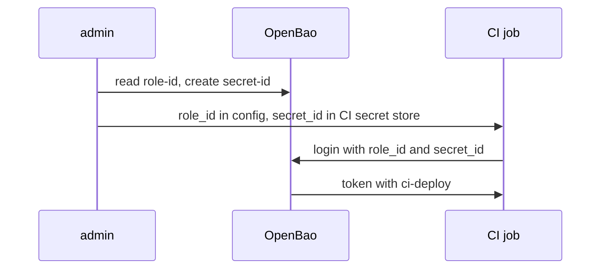

# AppRole For Jobs And Pipelines

A deployment job runs in a CI system outside the cluster. It has no Kubernetes ServiceAccount and no certificate, but the CI system can keep a secret for it. AppRole is built for this case: it splits the job's credential into two halves that are delivered separately, so neither half alone is enough to log in.

## Two halves: role_id and secret_id

**AppRole** is an auth method where a machine logs in with two values. The **`role_id`** identifies the role; it is not secret and can live in the job's configuration. The **`secret_id`** is the secret half; it can expire, be limited to a number of uses and be tied to a network. OpenBao only returns a token when both match.



The diagram shows the usual split: an administrator or a provisioning system fetches both values and delivers them through different channels, and the job exchanges them for a token. Enable AppRole and create the role for the CI job:

<!-- astrona:playground:renew -->

```sh
export BAO_ADDR=http://openbao.localtest.me:8200
export BAO_TOKEN=$(kubectl -n openbao get secret openbao-init -o jsonpath='{.data.root-token}' | base64 -d)
bao auth enable approle
bao write auth/approle/role/ci token_policies=ci-deploy token_ttl=20m token_max_ttl=30m secret_id_ttl=24h
```

The role says: tokens from this role get the policy `ci-deploy`, live 20 minutes and can be renewed up to 30 minutes, and each `secret_id` expires after 24 hours.

## Read the role_id, create a secret_id, log in

The `role_id` is fixed for the role, so you read it. A `secret_id` is generated each time you ask, so you write to the `secret-id` endpoint; `-f` sends a request with no data.

```sh
CI_ROLE_ID=$(bao read -field=role_id auth/approle/role/ci/role-id)
CI_SECRET_ID=$(bao write -f -field=secret_id auth/approle/role/ci/secret-id)
bao write auth/approle/login role_id=$CI_ROLE_ID secret_id=$CI_SECRET_ID
```

The login returns a token with the policies `default` and `ci-deploy` and a duration of 20 minutes. The job uses this token, and when it needs another one after the token expires, it logs in again with the same pair until the `secret_id` expires.

## Limit what a secret_id can do

A leaked `secret_id` is only dangerous if it is still valid and usable from where the attacker is. The role has settings for both:

| Setting | What it limits |
| --- | --- |
| `secret_id_ttl` | How long a `secret_id` stays valid |
| `secret_id_num_uses` | How many logins one `secret_id` allows (0 means unlimited) |
| `secret_id_bound_cidrs` | The client IP ranges a `secret_id` can be used from |
| `token_bound_cidrs` | The client IP ranges the resulting token can be used from |
| `bind_secret_id` | Whether a `secret_id` is required at all (keep it `true`) |

A `secret_id` for a one-off job can be limited to a single use:

```sh
ONE_USE_SECRET_ID=$(bao write -f -field=secret_id auth/approle/role/ci/secret-id num_uses=1)
bao write auth/approle/login role_id=$CI_ROLE_ID secret_id=$ONE_USE_SECRET_ID
bao write auth/approle/login role_id=$CI_ROLE_ID secret_id=$ONE_USE_SECRET_ID
```

The first login works; the second is refused with an error saying the `secret_id` is invalid, because it was used up. When a CIDR limit is wrong, the error looks similar: OpenBao refuses the `secret_id` without saying which limit failed, so check the role's settings with `bao read auth/approle/role/ci` when a login fails unexpectedly.

You now know how AppRole splits a machine's credential into a public `role_id` and a limited `secret_id`, and how to log in with them. The weak point is the delivery of the `secret_id`: something still has to hand it to the job. For pods in Kubernetes there is a way to avoid that delivery entirely.

## Common pitfalls

> [!WARNING]
> - **Storing the role_id and the secret_id in the same place.** Then the split protects nothing. Keep the `secret_id` in the CI system's secret store.
> - **A secret_id without a TTL.** It is valid until someone revokes it. Set `secret_id_ttl`.
> - **Setting `bind_secret_id=false` to make a login work.** Then the public `role_id` alone is a credential.
> - **CIDR limits that do not match where the job really runs.** The login is refused with an invalid `secret_id` error. Check the client's address and the role's `secret_id_bound_cidrs`.
