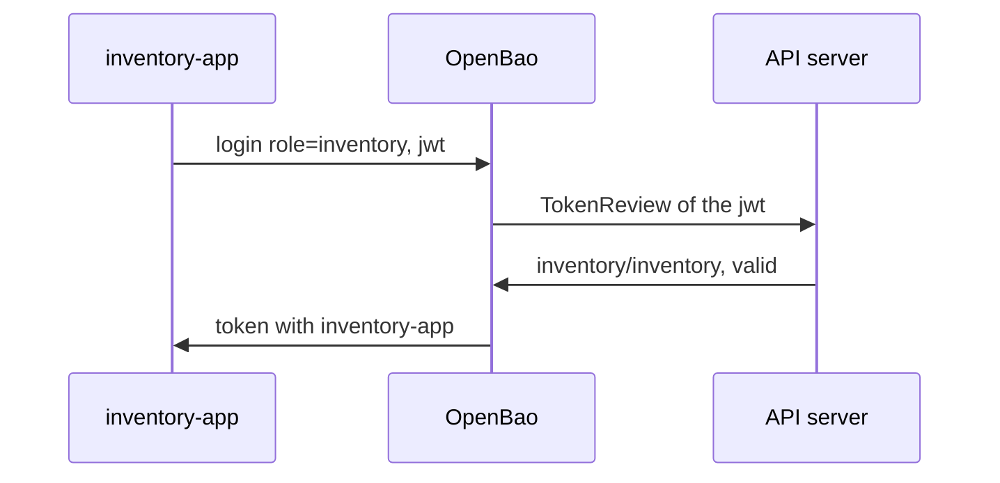

# Kubernetes Auth For Pods

A pod in Kubernetes already has an identity: its ServiceAccount, and a token that proves it, mounted into every container. Kubernetes auth lets the pod trade that token for an OpenBao token. Nobody has to copy a secret into the pod, and the pod gets only the policy its ServiceAccount is allowed.

## How the login works

**Kubernetes auth** is an auth method that checks a pod's ServiceAccount token. The pod sends the token and a role name to OpenBao. OpenBao asks the Kubernetes API server whether the token is valid, using the **TokenReview API**, and the API server answers with the ServiceAccount's name and namespace. OpenBao then checks those against the role and returns a token with the role's policies.



The diagram shows the three steps: the pod sends its ServiceAccount token, OpenBao has the API server review it, and OpenBao returns a token. OpenBao may only call the TokenReview API if its own ServiceAccount has the ClusterRole `system:auth-delegator`. The OpenBao Helm chart creates that binding by default (`server.authDelegator.enabled`).

## Configure the auth method

Because OpenBao runs in the same cluster, it can use its own ServiceAccount token and the cluster's certificate authority, which Kubernetes mounts into its pod. So the configuration needs only the address of the API server:

<!-- astrona:playground:renew -->

```sh
export BAO_ADDR=http://openbao.localtest.me:8200
export BAO_TOKEN=$(kubectl -n openbao get secret openbao-init -o jsonpath='{.data.root-token}' | base64 -d)
bao auth enable kubernetes
bao write auth/kubernetes/config kubernetes_host=https://kubernetes.default.svc
```

`https://kubernetes.default.svc` is the API server's address inside every cluster. If OpenBao ran outside the cluster, you would also give it a reviewer token (`token_reviewer_jwt`) and the cluster's certificate authority (`kubernetes_ca_cert`).

## Bind a role to one ServiceAccount

A role says which ServiceAccounts, in which namespaces, get which policies. Bind it as narrowly as you can:

```sh
bao write auth/kubernetes/role/inventory \
  bound_service_account_names=inventory \
  bound_service_account_namespaces=inventory \
  token_policies=inventory-app token_ttl=1h
```

Now log in from the pod itself. The pod reads its own token from the file Kubernetes mounts at `/var/run/secrets/kubernetes.io/serviceaccount/token`, and sends it with `curl`:

```sh
kubectl -n inventory exec deploy/inventory-app -- sh -c \
  'curl -s -X POST -d "{\"role\":\"inventory\",\"jwt\":\"$(cat /var/run/secrets/kubernetes.io/serviceaccount/token)\"}" http://openbao.localtest.me:8200/v1/auth/kubernetes/login'
```

The response is JSON with an `auth` block: `client_token` is the new OpenBao token, `policies` lists `default` and `inventory-app`, and `metadata` names the ServiceAccount and namespace that OpenBao learned from the TokenReview.

## Prove that other pods are refused

A login that works is only half the proof. The other half is that a pod with another ServiceAccount cannot use the role. `kubectl create token` creates a token for any ServiceAccount, which is a quick way to test:

```sh
OTHER_JWT=$(kubectl -n inventory create token default)
bao write auth/kubernetes/login role=inventory jwt=$OTHER_JWT
```

OpenBao refuses the login with an error that the ServiceAccount name is not authorized, because the role is bound to `inventory` only. A role bound to `*` would have accepted it, and so would every pod in the namespace.

You can now let a pod log in with nothing but its ServiceAccount, and bind the role so only that ServiceAccount in that namespace gets the policy. Combined with AppRole for jobs outside the cluster, that covers most machines.

## Common pitfalls

> [!WARNING]
> - **Binding a role to `*`.** Every ServiceAccount, or every namespace, then gets the policy. Name both.
> - **OpenBao cannot call TokenReview.** Without `system:auth-delegator`, every login fails with a permission error from the API server. Check the ClusterRoleBinding.
> - **A token from the wrong audience.** If you set `audience` on the role, the pod must use a projected token with that audience; the default mounted token has the API server's audience.
> - **Testing only the login that should work.** Always try one that should be refused.

## Your mission: Let The Inventory App And The CI Job Log In

You can now configure Kubernetes auth for a pod and AppRole for a job. The graded lab gives you both auth methods enabled but empty, and asks you to let the `inventory-app` pod log in with its ServiceAccount, give the CI job an AppRole with short lifetimes, and keep every other ServiceAccount out.

The lab runs in its own cluster, so first pause your playground. Nothing in it is lost:

```sh
astrona stop ats-113-playground-020-01
```

Then start the lab:

```sh
astrona run --git ssh://git@github.com/astrona-io/ATS113.git -c sections/section-020/module-01/labs/lab-01
```

The task is on the next page. Solve it on your own first. When you think you are done, send it for grading:

```sh
astrona submit -c sections/section-020/module-01/labs/lab-01
```

When the lab is done, remove it and start your playground again:

```sh
astrona destroy ats-113-lab-020-01
astrona start ats-113-playground-020-01
```
