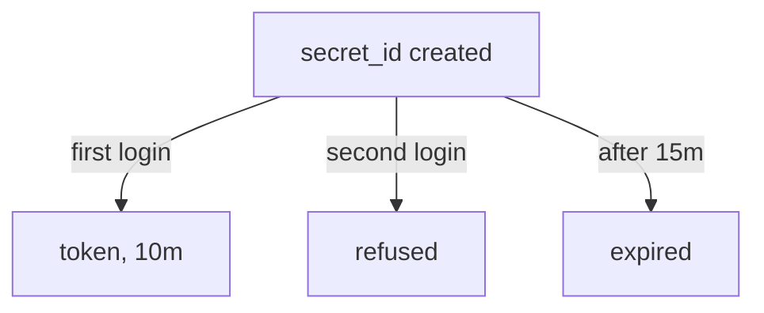

# Role Settings And The Role ID

A role decides what a successful login is worth. If it is wide, every leaked `secret_id` is worth a lot. This part reads a role field by field, so that you can write one that is narrow on purpose.

## Create a narrow role

Create a role for a deployment job. Each field has a safety reason, which the table after the command explains:

<!-- astrona:playground:renew -->

```sh
export BAO_ADDR=http://openbao.localtest.me:8200
export BAO_TOKEN=$(kubectl -n openbao get secret openbao-init -o jsonpath='{.data.root-token}' | base64 -d)
bao write auth/approle/role/deploy \
  token_policies=ci-deploy token_ttl=10m token_max_ttl=20m \
  secret_id_ttl=15m secret_id_num_uses=1
bao read auth/approle/role/deploy
```

The read lists all the fields of the role, including the ones that you did not set. The ones to check are:

| Field | Value here | Why |
| --- | --- | --- |
| `token_policies` | `ci-deploy` | The token gets only what the job needs |
| `token_ttl`, `token_max_ttl` | 10 minutes, 20 minutes | A stolen token expires soon |
| `secret_id_ttl` | 15 minutes | An unused `secret_id` expires |
| `secret_id_num_uses` | 1 | One login per `secret_id` |
| `bind_secret_id` | `true` (default) | The `role_id` alone cannot log in |
| `secret_id_bound_cidrs` | empty | Set it to the job's network when it is fixed |
| `token_bound_cidrs` | empty | Limits where the token can be used |

The combination of a 15 minute lifetime and a single use means that a `secret_id` is only useful once, for a short time, to whoever gets it first.

## The role ID

The `role_id` identifies the role. OpenBao generates a UUID (a random 128-bit identifier) when you create the role. Read it:

```sh
bao read auth/approle/role/deploy/role-id
```

The role ID is not secret, but treat it as configuration that belongs to the job. If you create roles through automation, you may want a predictable role ID, so that the job's configuration can be written before the role exists. Set it yourself:

```sh
bao write auth/approle/role/deploy/role-id role_id=deploy-job
bao read -field=role_id auth/approle/role/deploy/role-id
```

The second command prints `deploy-job`. Any `secret_id` created before the change stays valid, but the job must now send the new `role_id`.

## Test the login limits

Create a `secret_id`, log in twice and see the single-use rule work:

```sh
SECRET_ID=$(bao write -f -field=secret_id auth/approle/role/deploy/secret-id)
bao write auth/approle/login role_id=deploy-job secret_id=$SECRET_ID
bao write auth/approle/login role_id=deploy-job secret_id=$SECRET_ID
```

The first login returns a token with the policies `default` and `ci-deploy` and a `lease_duration` of `600` seconds. The second login fails with an invalid `secret_id` error, because the single permitted use was spent.



The diagram shows the three outcomes of a `secret_id` in this role: one login, then a refusal, or an expiry if nobody uses it.

You now know the fields that make a role narrow. Next is the question of how the `secret_id` is created and by whom.

## Common pitfalls

> [!WARNING]
> - **Leaving `secret_id_num_uses` at 0.** A `secret_id` then works until it expires, for any number of logins.
> - **Setting `bind_secret_id=false`.** The `role_id` alone then logs in, and it is not secret.
> - **Changing the `role_id` without updating the job.** Every login fails with an invalid `role_id` error.
> - **Reading the role as the root token and assuming the job sees the same.** The job's token has only the policies of the role.
