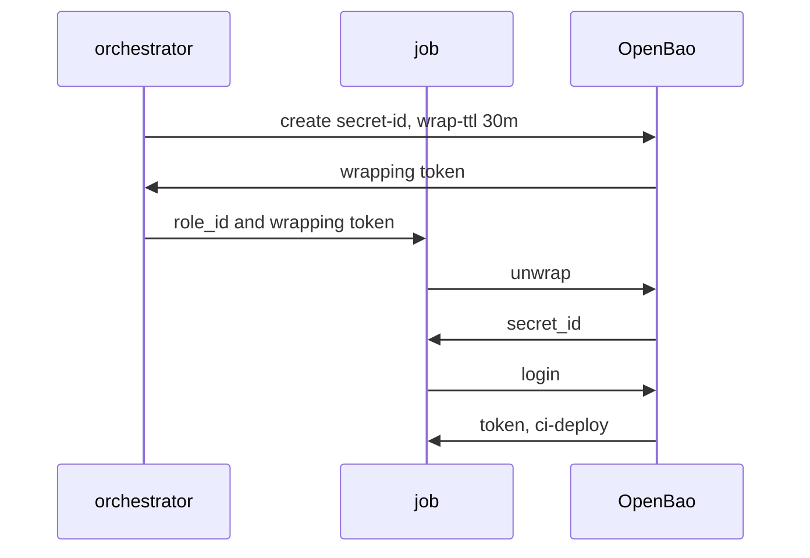

# Deliver A Secret ID Wrapped

The remaining problem is who sees the `secret_id`. If an administrator creates it and pastes it into the pipeline's settings, the administrator and every system on the way have seen it. The fix is a small program, the orchestrator, that creates `secret_id` values with the least possible rights, and wraps each one so only the job can read it.

## An orchestrator with a narrow policy

An **orchestrator** is the trusted program that provisions jobs. In AppRole it needs two rights on one role: read the `role_id` and create a `secret_id`. It does not need to read secrets, change the role or list other roles. Save this as `deploy-orchestrator.hcl`:

```hcl
path "auth/approle/role/deploy/role-id" {
  capabilities = ["read"]
}

path "auth/approle/role/deploy/secret-id" {
  capabilities = ["update"]
}
```

Write the policy, make sure the role exists and create a token for the orchestrator:

<!-- astrona:playground:renew -->

```sh
export BAO_ADDR=http://openbao.localtest.me:8200
export BAO_TOKEN=$(kubectl -n openbao get secret openbao-init -o jsonpath='{.data.root-token}' | base64 -d)
bao policy write deploy-orchestrator deploy-orchestrator.hcl
bao write auth/approle/role/deploy token_policies=ci-deploy token_ttl=10m token_max_ttl=20m secret_id_ttl=15m secret_id_num_uses=1
ORCHESTRATOR_TOKEN=$(bao token create -policy=deploy-orchestrator -ttl=1h -field=token)
```

Test the limits. The token can read the `role_id` and create a `secret_id`, and nothing else:

```sh
BAO_TOKEN=$ORCHESTRATOR_TOKEN bao read auth/approle/role/deploy/role-id
BAO_TOKEN=$ORCHESTRATOR_TOKEN bao read auth/approle/role/deploy
BAO_TOKEN=$ORCHESTRATOR_TOKEN bao kv get secret/ci/registry
```

The first command works. The second and the third fail with `permission denied`, because the policy does not allow reading the role's settings or any secret.

## Wrap the secret ID

Add `-wrap-ttl` to the creation, and the orchestrator receives a wrapping token instead of the `secret_id`:

```sh
WRAPPING_TOKEN=$(BAO_TOKEN=$ORCHESTRATOR_TOKEN bao write -wrap-ttl=30m -f -field=wrapping_token auth/approle/role/deploy/secret-id)
bao write sys/wrapping/lookup token=$WRAPPING_TOKEN
```

The lookup shows the creation path `auth/approle/role/deploy/secret-id` and a TTL of 30 minutes. The orchestrator never saw the `secret_id`. It passes only the wrapping token, for example as a Kubernetes Secret or a CI variable, and tells the job the `role_id`.

## What the job does

The job receives two things: the `role_id`, which can be written into its configuration, and the wrapping token. It unwraps the token to get the `secret_id`, and logs in:

```sh
ROLE_ID=$(bao read -field=role_id auth/approle/role/deploy/role-id)
SECRET_ID=$(bao unwrap -field=secret_id $WRAPPING_TOKEN)
bao write auth/approle/login role_id=$ROLE_ID secret_id=$SECRET_ID
```

The login returns a token with `default` and `ci-deploy`. The job has to unwrap before the wrapping TTL ends, and a second unwrap of the same token fails.



The diagram shows that the `secret_id` goes from OpenBao to the job only. The orchestrator and the channel between them carry the `role_id` and the wrapping token.

If the unwrap fails, the job has found that someone else used the token first. It stops, and the orchestrator creates a new `secret_id` after revoking the exposed one. The role's single-use rule is a second layer: even if the wrapping were bypassed, the first login spends the `secret_id`.

You can now deliver a `secret_id` without any person or program seeing it in clear text outside the job. The graded lab asks you to build exactly this setup.

## Common pitfalls

> [!WARNING]
> - **Giving the orchestrator `create` on `auth/approle/role/*`.** It can then create and change any role. Name the role.
> - **Using the root token to create the wrapped `secret_id`.** The point of the orchestrator policy is that a stolen orchestrator token cannot do more.
> - **A wrapping TTL longer than the `secret_id_ttl`.** The `secret_id` can expire while it is still wrapped. Keep the wrapping TTL shorter.
> - **Sending the `role_id` and the wrapping token together in one message.** Use different channels where you can.

## Your mission: Provision A Wrapped Secret ID

You can now write a narrow orchestrator policy and deliver a `secret_id` as a wrapping token. The graded lab asks you to set up the `deploy` role with single-use secret IDs, the orchestrator policy, and a wrapped `secret_id` created by an orchestrator token.

The lab runs in its own cluster, so first pause your playground. Nothing in it is lost:

```sh
astrona stop ats-113-playground-020-02
```

Then start the lab:

```sh
astrona run --git ssh://git@github.com/astrona-io/ATS113.git -c sections/section-020/module-02/labs/lab-01
```

The task is on the next page. Solve it on your own first. When you think you are done, send it for grading:

```sh
astrona submit -c sections/section-020/module-02/labs/lab-01
```

When the lab is done, remove it and start your playground again:

```sh
astrona destroy ats-113-lab-020-02
astrona start ats-113-playground-020-02
```
