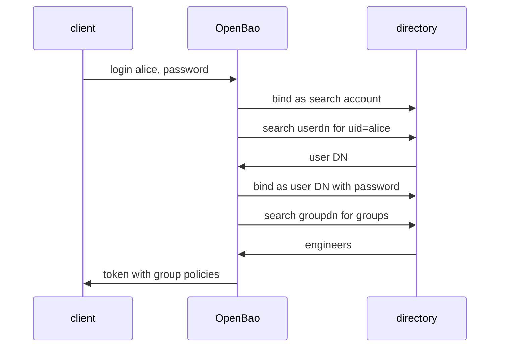

# How LDAP Login Works

An LDAP login looks like a password check, but OpenBao runs several separate directory requests for one login. If you know the steps, every setting has an obvious job and every error points to one step. This part follows one login from the request to the token.

## The steps of one login

A client sends the user name and the password to `auth/ldap/login/<username>`. OpenBao then talks to the directory server and takes these steps:

1. It connects to the directory at the configured `url`.
2. It **binds** as the search account, which means it authenticates to the directory with the `binddn` and `bindpass`. A bind is the LDAP word for "log in".
3. It searches below `userdn` for the entry whose `userattr` equals the user name, for example `uid=alice`. The search returns the user's DN.
4. It binds again as that DN with the password the client sent. If the directory accepts it, the password is right.
5. It searches below `groupdn` for the groups that contain the user, using `groupfilter`, and reads the name of each group from the attribute `groupattr`.
6. It looks up the policies mapped to the user and to each group, and creates a token with their union.



The diagram shows that the client's password only goes to the directory in step 4, and that OpenBao needs a second account, the search account, to find the user in the first place.

## The settings and the step they control

| Step | Setting | Example |
| --- | --- | --- |
| 1 | `url` | `ldap://openldap.ldap.svc.cluster.local:389` |
| 2 | `binddn`, `bindpass` | `cn=readonly,dc=example,dc=org` |
| 3 | `userdn`, `userattr` | `ou=people,dc=example,dc=org`, `uid` |
| 5 | `groupdn`, `groupattr`, `groupfilter` | `ou=groups,dc=example,dc=org`, `cn` |
| 6 | the group and user mappings | `auth/ldap/groups/engineers` |

The `userattr` is the attribute that matches the user name the client sends. It is `cn` by default. Many directories log people in by `uid` (OpenLDAP) or `sAMAccountName` (Active Directory), so this is the setting most often wrong.

The `groupfilter` is a search filter with two placeholders: `{{.Username}}` for the user name and `{{.UserDN}}` for the DN. The default filter matches the three common ways directories store membership: a `memberUid` attribute that holds the user name, and `member` or `uniqueMember` attributes that hold the DN:

```text
(|(memberUid={{.Username}})(member={{.UserDN}})(uniqueMember={{.UserDN}}))
```

## Why a search account is needed

A user's DN often does not look like the user name: `uid=alice,ou=people,...` for one user and `cn=Bob Example,ou=staff,...` for another. OpenBao cannot build the DN from the name, so it searches for it. The search needs a directory account that may read user entries. Give this account read access only, and no write rights. Without a `binddn`, OpenBao searches anonymously, and many directories refuse that.

OpenBao has other options for directories where a search is not wanted, for example `upndomain` for Active Directory. This module uses the search, which works for every layout.

You now know the six steps of a login and the setting behind each. The next part sets them up against a real directory.

## Common pitfalls

> [!WARNING]
> - **Leaving `userattr` at the default `cn` when users log in by `uid`.** The search finds nobody and the login fails.
> - **Giving the search account write rights.** A leaked `bindpass` then lets someone change the directory. Use a read-only account.
> - **Expecting a group to give access without a mapping.** Without a policy mapped to the group in OpenBao, group members get only the `default` policy.
> - **Using the password of a person as `bindpass`.** The account changes it or leaves. Use a service account.
