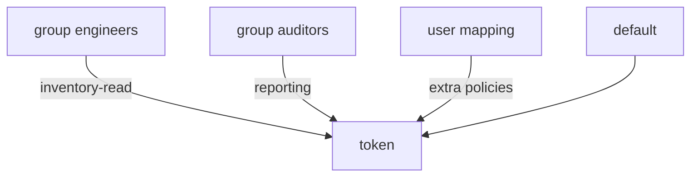

# Map Groups And Users To Policies

A password check only says that a person is who they claim to be. The policies decide what they may do. LDAP auth lets you attach policies to LDAP groups and to single users, and the token gets the combination. This part builds the mapping and shows the rules for people with several groups or none.

## Map a group

A **group mapping** is an object at `auth/ldap/groups/<group name>` that lists the policies for members of that group. The group name is the value of the `groupattr` attribute, `cn` in this setup. Map the `engineers` group to `inventory-read` and the `auditors` group to `reporting`:

<!-- astrona:playground:renew -->

```sh
export BAO_ADDR=http://openbao.localtest.me:8200
export BAO_TOKEN=$(kubectl -n openbao get secret openbao-init -o jsonpath='{.data.root-token}' | base64 -d)
bao auth enable ldap
bao write auth/ldap/config \
  url=ldap://openldap.ldap.svc.cluster.local:389 \
  binddn=cn=readonly,dc=example,dc=org bindpass=readonly-password \
  userdn=ou=people,dc=example,dc=org userattr=uid \
  groupdn=ou=groups,dc=example,dc=org groupattr=cn
bao write auth/ldap/groups/engineers policies=inventory-read
bao write auth/ldap/groups/auditors policies=reporting
```

The group mapping field is named `policies`. Log in as Alice, who is in `engineers`, and as Bob, who is in `auditors`:

```sh
bao write auth/ldap/login/alice password=alice-password
bao write auth/ldap/login/bob password=bob-password
```

Alice's token has `default` and `inventory-read`. Bob's has `default` and `reporting`. OpenBao found each group in the directory at login, so a change in the directory takes effect at the next login without any change in OpenBao.

## Map a single user

A **user mapping** at `auth/ldap/users/<username>` adds policies for one person, on top of what the groups give. It also lets a person log in who is in no group. Give Carol, who is in no group, a policy of her own:

```sh
bao write auth/ldap/users/carol policies=reporting
bao write auth/ldap/login/carol password=carol-password
```

Carol's token has `default` and `reporting`. The user mapping alone gave her the policy.

## The rule for combining

The token gets the union of the `default` policy, the policies of every group the user belongs to, and the policies of the user mapping. A user who is in two mapped groups gets both sets. Test it by adding Alice to a second mapping:

```sh
bao write auth/ldap/users/alice policies=reporting
bao write -format=json auth/ldap/login/alice password=alice-password | jq '.auth.policies'
```

The list now has `default`, `inventory-read` and `reporting`. A user in no mapped group and with no user mapping gets only `default`, so they can log in and can do nothing.



The diagram shows that every source adds to the token and none of them removes a policy.

## Case and names

LDAP names are not case sensitive, but OpenBao compares group and user names as lowercase by default. A group `Engineers` in the directory is matched by a mapping named `engineers`. The setting `case_sensitive_names=true` turns this off and then requires exact case. Keep the default unless the directory has two groups that differ only in case.

Check which policies a mapping really holds with `bao read`:

```sh
bao read auth/ldap/groups/engineers
bao list auth/ldap/groups
```

You can now turn directory membership into OpenBao policies and predict the result for any user. The graded lab asks you to configure the method from nothing and map two groups.

## Common pitfalls

> [!WARNING]
> - **Naming the mapping after the group's DN.** The name is the `groupattr` value, such as `engineers`.
> - **Expecting a removed directory group to revoke a live token.** Tokens keep their policies until they expire. Keep the TTL short for sensitive groups.
> - **Mapping `root` to a group.** Everyone in the group would be a superuser. Map the smallest policy.
> - **Assuming a user with no group is refused.** The login works and the token has only `default`.

## Your mission: Log In From The Directory

You can now configure LDAP auth and map groups to policies. The graded lab asks you to set up the method for the playground's directory, map the engineering and audit groups, and prove that each person gets the right access.

The lab runs in its own cluster, so first pause your playground. Nothing in it is lost:

```sh
astrona stop ats-113-playground-030-02
```

Then start the lab:

```sh
astrona run --git ssh://git@github.com/astrona-io/ATS113.git -c sections/section-030/module-02/labs/lab-01
```

The task is on the next page. Solve it on your own first. When you think you are done, send it for grading:

```sh
astrona submit -c sections/section-030/module-02/labs/lab-01
```

When the lab is done, remove it and start your playground again:

```sh
astrona destroy ats-113-lab-030-02
astrona start ats-113-playground-030-02
```
