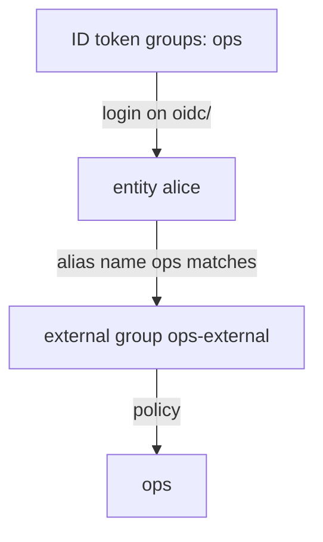

# Internal And External Groups

The ops team has ten people, and all of them need the same policy. Granting it ten times, and remembering to remove it when someone leaves, is how access drifts. Groups give policies to many entities at once, and an external group can even take its members straight from Keycloak.

## Token policies and identity policies

A token can get policies from two places. **Token policies** come from the auth method's role or user and are fixed when the token is created. **Identity policies** come from the entity and its groups, and OpenBao checks them on every request. So adding an entity to a group gives its existing tokens the group's policies at once, without a new login. A token lookup shows both lists, `policies` and `identity_policies`.

## Internal groups

An **internal group** is a group whose members you set in OpenBao: a list of entity IDs and of other groups. Create one for the ops team with the policy `ops-shared`, and put alice's entity in it:

<!-- astrona:playground:renew -->

```sh
export BAO_ADDR=http://openbao.localtest.me:8200
export BAO_TOKEN=$(kubectl -n openbao get secret openbao-init -o jsonpath='{.data.root-token}' | base64 -d)
bao write identity/entity name=alice
ALICE_ENTITY_ID=$(bao read -field=id identity/entity/name/alice)
bao write identity/group name=ops type=internal policies=ops-shared member_entity_ids=$ALICE_ENTITY_ID
bao read identity/group/name/ops
```

`bao write identity/entity name=alice` creates the entity, or leaves it as it is if alice already has one. The group shows `type` as `internal`, the policy `ops-shared` and alice's entity ID as a member.

Now check that a login as alice carries the group's policy. The userpass user `alice` must be linked to the entity `alice` by an alias; if the alias already exists, OpenBao refuses the second one, which is fine:

```sh
USERPASS_ACCESSOR=$(bao auth list -format=json | jq -r '."userpass/".accessor')
bao write identity/entity-alias name=alice canonical_id=$ALICE_ENTITY_ID mount_accessor=$USERPASS_ACCESSOR
ALICE_TOKEN=$(bao write -field=token auth/userpass/login/alice password=alice-password)
bao token lookup -format=json $ALICE_TOKEN | jq '{policies: .data.policies, identity_policies: .data.identity_policies}'
```

`identity_policies` contains `ops-shared`, from the group. Remove alice from the group with `bao write identity/group name=ops type=internal policies=ops-shared member_entity_ids=""` and look the same token up again: `ops-shared` is gone, without a new login.

## External groups

An **external group** takes its members from the identity provider. You do not list members; you give the group a **group alias** whose name matches a group name the auth method sees, here an entry in the ID token's `groups` claim, on the mount given by its accessor. At every JWT or OIDC login, OpenBao reads the claim and adds the entity to every external group whose alias matches.



The diagram shows the chain: the `groups` claim names `ops`, the group alias named `ops` on the `oidc/` mount matches, and the entity joins the group with its policy. Create it:

```sh
OIDC_ACCESSOR=$(bao auth list -format=json | jq -r '."oidc/".accessor')
bao write identity/group name=ops-external type=external policies=ops
OPS_GROUP_ID=$(bao read -field=id identity/group/name/ops-external)
bao write identity/group-alias name=ops mount_accessor=$OIDC_ACCESSOR canonical_id=$OPS_GROUP_ID
```

Log in as alice with a JWT and look at the token's `identity_policies`: it contains `ops`. When Keycloak removes alice from the group `ops`, her next login no longer joins the external group. The group alias name must match the claim exactly, including case.

You now know how to give policies to many entities, by hand with internal groups or from Keycloak with external groups, and you know that identity policies change on existing tokens. That is what the lab asks you to put together.

## Common pitfalls

> [!WARNING]
> - **Adding members to an external group by hand.** OpenBao manages external group membership from logins; use an internal group if you want to set members yourself.
> - **A group alias name that differs in case or path.** `Ops` or `/ops` does not match a claim value of `ops`.
> - **A group alias on the wrong mount accessor.** It must be the accessor of the auth mount the person logs in through.
> - **Looking only at `policies`.** Group policies appear in `identity_policies`.

## Your mission: Give Alice One Identity Across Two Logins

You can now link two logins to one entity and give that entity policies through a group. The graded lab gives you userpass and JWT login for alice, with no entities yet, and asks you to create one entity with both aliases and put it in an internal group with a shared policy.

The lab runs in its own cluster, so first pause your playground. Nothing in it is lost:

```sh
astrona stop ats-113-playground-040-01
```

Then start the lab:

```sh
astrona run --git ssh://git@github.com/astrona-io/ATS113.git -c sections/section-040/module-01/labs/lab-01
```

The task is on the next page. Solve it on your own first. When you think you are done, send it for grading:

```sh
astrona submit -c sections/section-040/module-01/labs/lab-01
```

When the lab is done, remove it and start your playground again:

```sh
astrona destroy ats-113-lab-040-01
astrona start ats-113-playground-040-01
```
