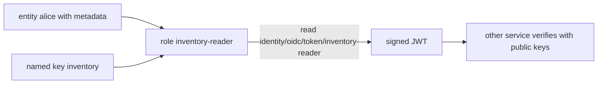

# Issue Identity Tokens

An OpenBao client token only means something to OpenBao. An **identity token** is a signed JWT that says who the entity is. Another service can check the signature with OpenBao's public keys and trust the claims, without holding an OpenBao token or calling OpenBao on every request. This part sets up the three pieces: a key, a role and a token read.



## The named key

The key signs the tokens. Create a named key with its algorithm and its lifetimes:

<!-- astrona:playground:renew -->

```sh
export BAO_ADDR=http://openbao.localtest.me:8200
export BAO_TOKEN=$(kubectl -n openbao get secret openbao-init -o jsonpath='{.data.root-token}' | base64 -d)
bao write identity/oidc/key/inventory algorithm=RS256 rotation_period=24h verification_ttl=24h allowed_client_ids="*"
bao read identity/oidc/key/inventory
```

- `algorithm` is the signing algorithm. `RS256` is the default and the one most receivers support. The others include `RS384`, `RS512`, `ES256`, `ES384`, `ES512` and `EdDSA`.
- `rotation_period` is how often OpenBao makes a new signing key by itself. The default is 24 hours.
- `verification_ttl` is how long the public part of a key stays published after it is no longer used to sign, so tokens signed with it still verify. The default is 24 hours.
- `allowed_client_ids` lists the roles that may use the key, by client ID. The value `*` allows every role.

## The role

A role names a key, sets the token lifetime and holds the claims template. The template is a JSON object. Values in double curly braces are replaced with facts from the entity at the time the token is read. Save this as `template.json`:

```json
{
  "team": {{identity.entity.metadata.team}},
  "name": {{identity.entity.name}}
}
```

Create the role. The `@` makes the CLI read the template from the file:

```sh
bao write identity/oidc/role/inventory-reader key=inventory ttl=30m template=@template.json
bao read identity/oidc/role/inventory-reader
```

The read shows the role's `client_id`, which OpenBao generated. That value goes into the token as the audience. Common template values are:

| Template value | Gives |
| --- | --- |
| `{{identity.entity.id}}` | The entity ID |
| `{{identity.entity.name}}` | The entity name |
| `{{identity.entity.metadata.<key>}}` | One metadata value |
| `{{identity.entity.aliases.<mount accessor>.name}}` | The alias name on one mount |
| `{{identity.entity.groups.names}}` | The names of the entity's groups |

The template may not set the reserved claims `iss`, `sub`, `aud`, `exp`, `nbf` or `iat`. OpenBao sets those. If a metadata key is missing from the entity, the claim is empty, so check the entity before you debug the role.

## Read a token as the entity

An identity token is read, not written, and it is issued for the entity of the token that makes the call. Log in as Alice through userpass and read the token with the token that login returns. The policy `identity-reader` allows reading `identity/oidc/token/*`:

```sh
ALICE_TOKEN=$(bao write -field=token auth/userpass/login/alice password=alice-password)
BAO_TOKEN=$ALICE_TOKEN bao read -format=json identity/oidc/token/inventory-reader
```

The response has `token` (the JWT), `client_id` and `ttl`. A JWT is three base64url parts separated by dots: header, payload and signature. Decode the payload with `jq`:

```sh
JWT=$(BAO_TOKEN=$ALICE_TOKEN bao read -field=token identity/oidc/token/inventory-reader)
printf '%s' "$JWT" | jq -R 'split(".")[1] | gsub("-";"+") | gsub("_";"/") | @base64d | fromjson'
```

The payload has `iss` (the issuer), `sub` (the entity ID), `aud` (the role's client ID), `iat` and `exp` (issue time and expiry, 30 minutes apart), and the two claims from the template. The root token cannot read an identity token, because it has no entity. A token with no entity gets an error.

## Your mission: Issue Identity Tokens For Alice

You can now create a key and a role, and read an identity token as an entity. The graded lab asks you to give Alice's entity the metadata `team=inventory`, create the key `inventory` and the role `inventory-reader` with a claims template for `team` and `name`, and prove that Alice reads a token with those claims.

The lab runs in its own cluster, so first pause your playground. Nothing in it is lost:

```sh
astrona stop ats-113-playground-040-02
```

Then start the lab:

```sh
astrona run --git ssh://git@github.com/astrona-io/ATS113.git -c sections/section-040/module-02/labs/lab-01
```

The task is on the next page. Solve it on your own first. When you think you are done, send it for grading:

```sh
astrona submit -c sections/section-040/module-02/labs/lab-01
```

When the lab is done, remove it and start your playground again:

```sh
astrona destroy ats-113-lab-040-02
astrona start ats-113-playground-040-02
```

## Common pitfalls

> [!WARNING]
> - **Reading the token with the root token.** The root token has no entity, so there are no claims to build.
> - **Setting reserved claims in the template.** OpenBao rejects `iss`, `sub`, `aud`, `exp`, `nbf` and `iat`.
> - **Forgetting the policy.** Without a rule that allows `read` on `identity/oidc/token/<role>`, the read returns `permission denied`.
> - **Using a role the key does not allow.** If `allowed_client_ids` does not include the role's client ID or `*`, the token cannot be issued.
> - **Quoting the template values.** The braces are replaced with a JSON string. Do not add quotes around them.
